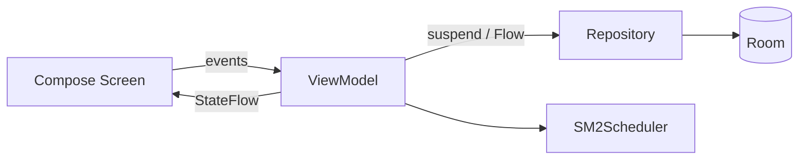

# ADR-0001: MVVM with Repository Pattern

- **Status:** Accepted
- **Date:** 2026-10-14
- **Deciders:** Patrick Baumgartner

## Context

Spaced Repeater needs a clear separation between Compose UI, business rules, and persistence. Candidate approaches:

1. **MVVM + Repository** — ViewModels expose state; repositories own data access; domain rules sit in between.
2. **MVI** — strict intent/reducer/state machine in the UI layer.
3. **MVC** — controller-centric; poor fit for Compose.

Constraints: single Activity with Compose navigation, reactive data from Room, and consistency with the esp32-room-watchdog-android reference project. The scheduling core must be testable without Android.

## Decision

Adopt **MVVM with the Repository pattern**:

- Screens (`HomeScreen`, `StudyScreen`, `ImportScreen`) render state and forward user intents; no logic.
- ViewModels hold screen state as `StateFlow` and orchestrate use cases via repositories and the pure `SM2Scheduler`.
- Repositories are the single source of truth, wrapping Room DAOs and owning transaction boundaries.
- Domain models and the scheduler live in a framework-free `domain/` layer.

## Consequences

**Positive**

- Clear, boring, well-understood structure; matches the watchdog reference and Android guidance.
- Room `Flow`s make decks and due counts reactive without manual refresh.
- Scheduler and parser test on the JVM; UI testable via ViewModel fakes.

**Negative**

- Slightly more files than a monolithic screen approach.
- MVI's stricter effect handling is approximated, not fully enforced, for one-off UI events.
