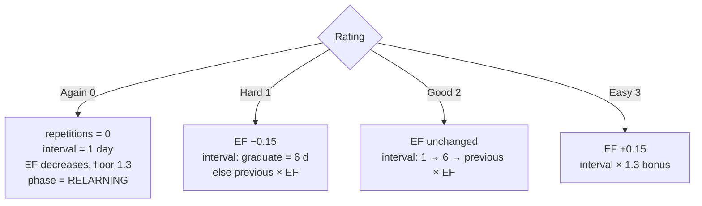

# ADR-0004: SM-2 Scheduling Algorithm (Anki Variant)

- **Status:** Accepted
- **Date:** 2026-10-14
- **Deciders:** Patrick Baumgartner

## Context

The app's core promise is "works exactly like Anki". The scheduler decides when every card reappears and is the most correctness-critical component. Options:

1. **SM-2 (Anki variant)** — simple, deterministic, proven over decades; parameters: repetitions, ease factor, interval.
2. **FSRS** — modern, more accurate per-review intervals, but more complex and parameter-heavy.
3. **Custom heuristic** — full control, unproven.
4. **AnkiDroid library reuse** — heavy dependency coupling for a narrow need.

The initial scope chooses SM-2 and defers FSRS, as described in the
[product goals](../arc42/01-introduction-and-goals.md#11-requirements-overview).

## Decision

Implement **SM-2 as an Anki-compatible variant** in a pure Kotlin `SM2Scheduler`:

- Ratings: Again (0), Hard (1), Good (2), Easy (3).
- Graduation: first correct → 1 day, second → 6 days, then `round(previousInterval × easeFactor)`.
- Ease update: `newEF = oldEF + (0.1 − (5 − r) × (0.08 + (5 − r) × 0.02))`, floored at **1.3**.
- Easy bonus: interval × 1.3.
- Lapse (Again): interval resets to 1, EF decreases (≥ 1.3), repetitions reset, card re-enters learning.
- Learning steps for new/lapsed cards: **1 min → 10 min → graduate**.

The scheduler is a pure function `(CardState, ReviewRating) → CardSchedule` with **no Android or Room dependencies**, so it can be swapped (FSRS) without touching UI or persistence.

## Consequences

**Positive**

- Deterministic, explainable scheduling matching Anki; easy to reason about and to test exhaustively on the JVM.
- Pure-function core keeps the highest-risk logic fully unit-testable (sub-second suites).
- Clean seam for a future FSRS swap (same `(state, rating) → schedule` contract).

**Negative**

- SM-2 is less accurate than modern algorithms (e.g. FSRS) for retention prediction.
- Reproducing Anki's exact edge-case behavior (rounding, bonus application order) requires golden tests.
