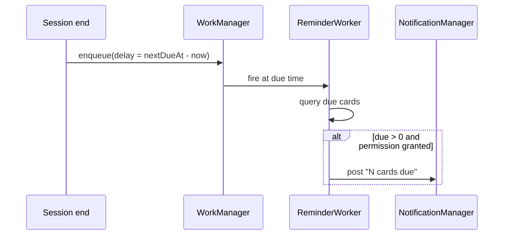

# ADR-0007: WorkManager for Review Reminders

- **Status:** Accepted
- **Date:** 2026-10-14
- **Deciders:** Patrick Baumgartner

## Context

Reminders should fire when cards are actually due (derived from SM-2 due dates), survive process death and reboots, and respect battery health. Options:

1. **WorkManager** — deferred work with OS persistence, constraints, reboot survival.
2. **AlarmManager exact alarms** — precise timing, battery-hostile, extra permission on API 31+.
3. **Foreground service** — overkill, permanent notification, battery cost.
4. **No reminders** — simplest, but hurts the study habit loop.

Reminders are best-effort, not mission-critical: a missed notification costs nothing.

## Decision

Use **WorkManager** to schedule one-time review reminders. After each session, `ReviewReminderService` computes the next due timestamp and enqueues a `OneTimeWorkRequest` with the corresponding delay. The worker queries the due count and posts a notification only if `POST_NOTIFICATIONS` is granted and cards are actually due.

## Consequences

**Positive**

- Work requests persist across process death and reboots — no alarm re-registration logic.
- OS-scheduled, battery-friendly; integrates cleanly with Hilt-managed workers.
- Graceful degradation: no permission or no due cards simply means no notification.

**Negative**

- Timing is inexact (WorkManager may defer by minutes) — acceptable for reminders, wrong for precise alarms.
- One more subsystem to test (worker + permission paths).
