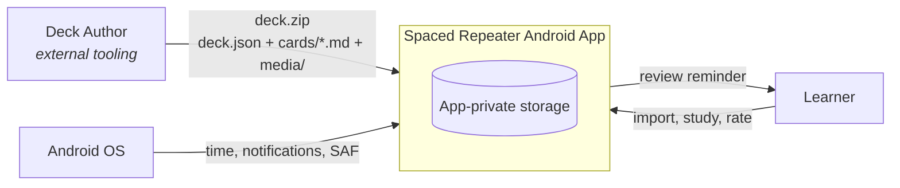
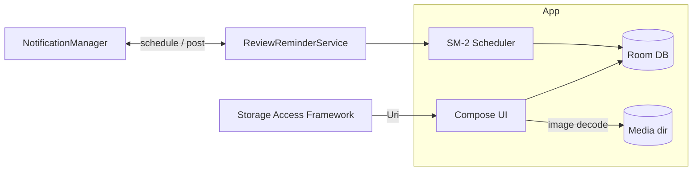

# 3. System Scope and Context

## 3.1 Business Context

Spaced Repeater is a self-contained mobile application. It communicates with **no external systems at runtime**. Its only boundary is the deck package format, produced by external tooling.

| Neighbor | Input | Output |
|----------|-------|--------|
| Learner (person) | Deck archives, taps, ratings | Decks list, study UI, progress, notifications |
| Deck package producer (external) | `deck.zip` per deck format spec | — |
| Android OS | File URIs (SAF), clock, notification channel | Permission grants, notification delivery |

## 3.2 Technical Context

The app is offline by design; there is no runtime network boundary. The only integration points are platform channels:

- **Storage Access Framework (SAF)** — deck archive selection; no storage permission needed on API 33+, `READ_EXTERNAL_STORAGE` only on API < 33.
- **NotificationManager / WorkManager** — reminder scheduling and delivery.
- **File system (app-private)** — extracted media images.

The declared `INTERNET` permission exists only to keep the door open for future sync; the app performs no network I/O.
