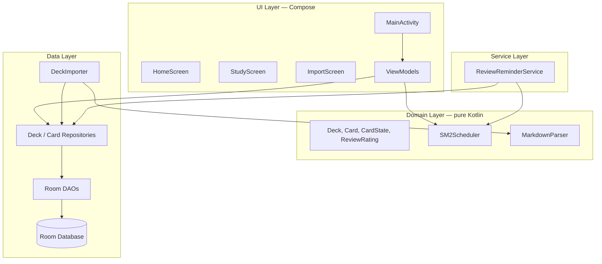
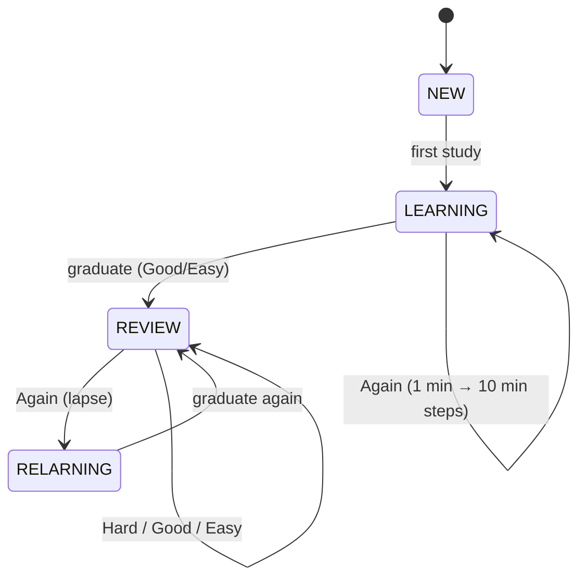

# 5. Building Block View

## 5.1 Whitebox: Overall System



**Layers (top → bottom):**

| Layer | Responsibility | Depends on |
|-------|----------------|------------|
| UI | Render state, collect user intent, navigate | ViewModels, domain models |
| Domain | Business rules: scheduling, parsing, models | Nothing (pure Kotlin) |
| Data | Persistence, import, expose reactive queries | Room, domain models |
| Service | Background reminder scheduling | WorkManager, repositories |

The dependency rule: **UI → Domain ← Data**. The domain layer never imports Android or Room types, keeping the scheduler and parser unit-testable on the JVM.

## 5.2 Package Structure

```
com.patbaumgartner.android.spacedrepeater
├── SpacedRepeaterApp.kt           # @HiltAndroidApp, DI graph root
├── data/
│   ├── deck/                      # DeckRepository, DeckDao
│   ├── card/                      # CardRepository, CardDao, CardStateDao
│   ├── import/                    # DeckImporter (ZIP), MarkdownParser
│   └── scheduler/                 # SM2Scheduler
├── domain/model/                  # Deck, Card, CardState, ReviewRating
├── ui/
│   ├── theme/                     # Color, Font (Manrope), Theme (Material 3)
│   ├── MainActivity.kt            # Single activity, nav host
│   ├── AppViewModel.kt
│   ├── screens/                   # HomeScreen, StudyScreen, ImportScreen
│   └── components/                # FlashcardView, RatingButtons
└── service/
    └── ReviewReminderService.kt   # WorkManager scheduling
```

## 5.3 Building Block Details

### UI Layer

| Block | Responsibility |
|-------|----------------|
| `MainActivity` | Single activity host; sets theme, installs navigation. |
| `HomeScreen` | Deck list with due badges, progress; import FAB; stats entry. |
| `StudyScreen` | Session loop: question → reveal → rate → next; undo; progress bar. |
| `ImportScreen` | SAF launch, preview, progress, result. |
| `StatsScreen` | Cards studied today, retention rate, day streak; refreshes on every visit so recent reviews are reflected immediately. |
| `FlashcardView` | Renders markdown front/back, optionally an image. |
| `RatingButtons` | Again / Hard / Good / Easy row; emits rating events. |

ViewModels expose a single immutable UI state via `StateFlow`; one-off effects (navigation, snackbars) flow through one-shot events.

### Domain Layer

| Block | Responsibility |
|-------|----------------|
| `SM2Scheduler.calculateNextReview(state, rating)` | Pure function → `CardSchedule(interval, easeFactor, dueDate, nextState)`. Implements the Anki SM-2 rules incl. learning steps and the 1.3 ease floor. |
| `MarkdownParser` | Splits card markdown into front/back via `---` separators and `# Question` / `# Answer` headings; extracts image references. |

### Data Layer

| Block | Responsibility |
|-------|----------------|
| `DeckRepository` / `CardRepository` | Facades over DAOs; expose `Flow` for UI and suspend functions for writes; own transaction boundaries. |
| `CardDao` / `CardStateDao` / `DeckDao` | Room queries: due selection (`dueDate <= now` ordered by overdue), aggregates for badges. |
| `DeckImporter` | Streams the ZIP (`ZipInputStream`) to a temp dir, validates `deck.json`, parses cards, copies media, persists everything in one transaction. |

### Service Layer

| Block | Responsibility |
|-------|----------------|
| `ReviewReminderService` | Schedules a one-time WorkManager task at the next due timestamp; posts a notification if permission granted and cards are due. |

## 5.4 Data Model

```mermaid
erDiagram
    DECK ||--o{ CARD : contains
    CARD ||--|| CARD_STATE : has
    CARD ||--o{ REVIEW_LOG : records

    DECK {
        long id PK
        string name
        string description
        long created_at
        int card_count
        long last_studied_at
    }
    CARD {
        long id PK
        long deck_id FK
        string front
        string back
        string tags
        long created_at
    }
    CARD_STATE {
        long card_id PK_FK
        int repetitions
        float ease_factor
        int interval
        long due_date
        long last_reviewed_at
        string state
    }
    REVIEW_LOG {
        long id PK
        long card_id FK
        long reviewed_at
        int rating
        int interval
        float ease_factor
        long time_taken_ms
        string previous_phase
    }
```

State machine per card:


