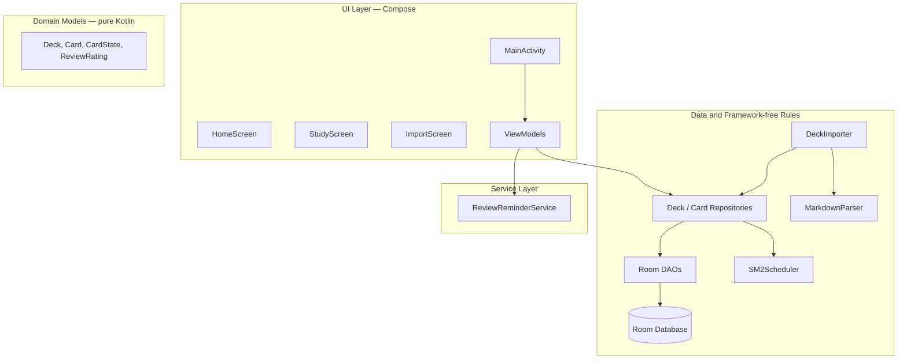
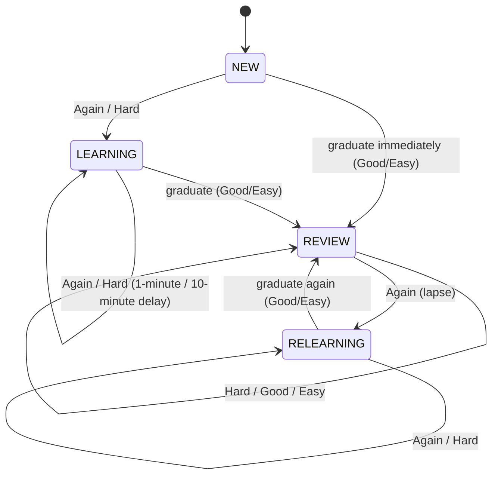

# 5. Building Block View

## 5.1 Whitebox: Overall System



**Layers (top → bottom):**

| Layer | Responsibility | Depends on |
|-------|----------------|------------|
| UI | Render state, collect user intent, navigate | ViewModels, domain models |
| Domain models | Card/deck/review value types and phases | Nothing (pure Kotlin) |
| Data | Persistence, import, scheduling rules, reactive queries | Room, domain models |
| Service | Background reminder scheduling and delivery | WorkManager, DAOs, preferences |

The dependency rule is **UI → Domain models ← Data**. The scheduler and parser
also avoid Android and Room imports, keeping the correctness-critical rules
unit-testable on the JVM despite living under `data/`.

## 5.2 Package Structure

```
com.patbaumgartner.android.spacedrepeater
├── SpacedRepeaterApp.kt           # @HiltAndroidApp, DI graph root
├── data/
│   ├── importing/                 # ZIP reader, importer, MarkdownParser, media store
│   ├── local/                     # Room database, DAOs, entities, migrations
│   ├── repository/                # Deck, Card, Stats, limits, preferences
│   └── scheduler/                 # Framework-free SM2Scheduler
├── domain/model/                  # Deck, Card, CardState, ReviewRating
├── di/                            # Hilt production bindings
├── ui/
│   ├── theme/                     # Color, Font (Manrope), Theme (Material 3)
│   ├── MainActivity.kt            # Single activity, navigation, notification request
│   ├── CardContent.kt             # Safe text/image block rendering
│   └── screens/                   # Screens and ViewModels
└── service/
    └── ReviewReminderService.kt   # WorkManager scheduling and reminder worker
```

## 5.3 Building Block Details

### UI Layer

| Block | Responsibility |
|-------|----------------|
| `MainActivity` | Single activity host; sets theme, installs navigation, requests notification permission when appropriate. |
| `HomeScreen` | Deck list with due badges, progress; import, stats, and settings entries. |
| `StudyScreen` | Session loop: question → reveal → rate → next; undo; progress and rating controls. |
| `ImportScreen` | SAF launch, preview, progress, result. |
| `StatsScreen` | Cards studied today, retention rate, day streak; refreshes on every visit. |
| `CardContent` | Renders the supported Markdown subset and app-private images. |

ViewModels expose immutable UI state via `StateFlow`; screens forward user
intents and navigation is hosted by `MainActivity`.

### Framework-free Rules

| Block | Responsibility |
|-------|----------------|
| `SM2Scheduler.calculateNextReview(state, rating)` | Pure function → `CardSchedule(interval, easeFactor, dueAt, nextPhase)`. Implements the documented Anki-style SM-2 rules and 1.3 ease floor. |
| `MarkdownParser` | Splits card markdown into front/back via `---` separators and optional `# Question` / `# Answer` headings. |

### Data Layer

| Block | Responsibility |
|-------|----------------|
| `DeckRepository` / `CardRepository` | Facades over DAOs; expose `Flow` for UI and suspend functions for writes; own transaction boundaries. |
| `CardDao` / `CardStateDao` / `DeckDao` | Room queries: due selection (`dueDate <= now` ordered by learning phase and due date), aggregates for badges. |
| `DeckImporter` | Streams the ZIP to app-private staging, validates `deck.json`, parses cards, commits deck/cards/states atomically, then moves media into place. |

### Service Layer

| Block | Responsibility |
|-------|----------------|
| `ReviewReminderService` | Schedules or cancels the uniquely named one-time WorkManager task. |
| `ReviewReminderWorker` | Re-checks preferences, due cards, and API-level notification permission before posting. |

## 5.4 Data Model

```mermaid
erDiagram
    DECK ||--o{ CARD : contains
    CARD ||--|| CARD_STATE : has
    CARD ||--o{ REVIEW_LOG : records

    DECK {
        long id PK
        string name
        string description
        long created_at
        int card_count
        long last_studied_at
    }
    CARD {
        long id PK
        long deck_id FK
        string front
        string back
        string tags
        long created_at
    }
    CARD_STATE {
        long card_id PK_FK
        int repetitions
        float ease_factor
        int interval
        long due_date
        long last_reviewed_at
        string state
    }
    REVIEW_LOG {
        long id PK
        long card_id FK
        long reviewed_at
        int rating
        int interval
        float ease_factor
        long time_taken_ms
        string previous_phase
    }
```

For reviews written at schema v2, `previousPhase` is the actual pre-review phase.
Migrated v1 history is intentionally less precise: the earliest row per card is
`NEW`, and every later `REVIEW` is only a non-NEW sentinel for new-card-budget
accounting. It is not an exact historical `LEARNING`/`RELEARNING` phase and is
not used for scheduling or replay; the card's current state is preserved.

State machine per card:


