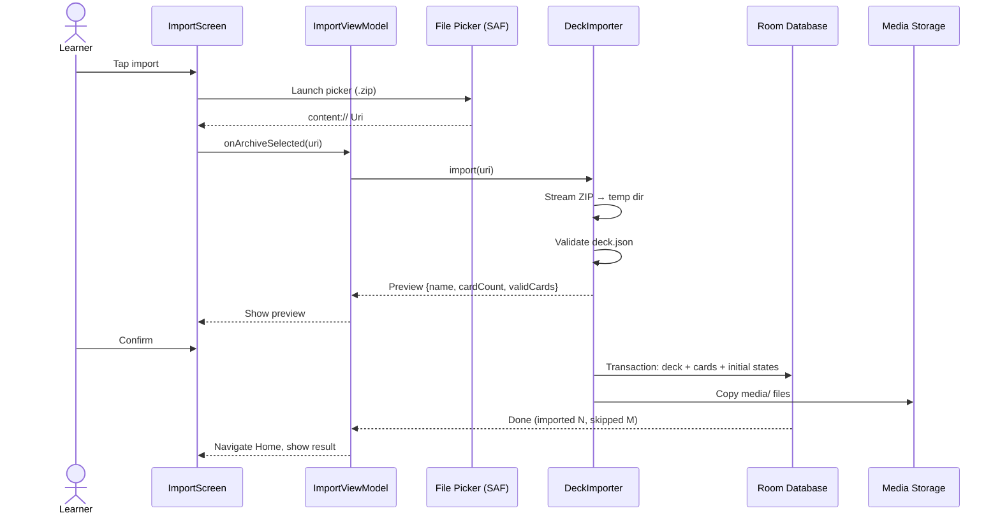
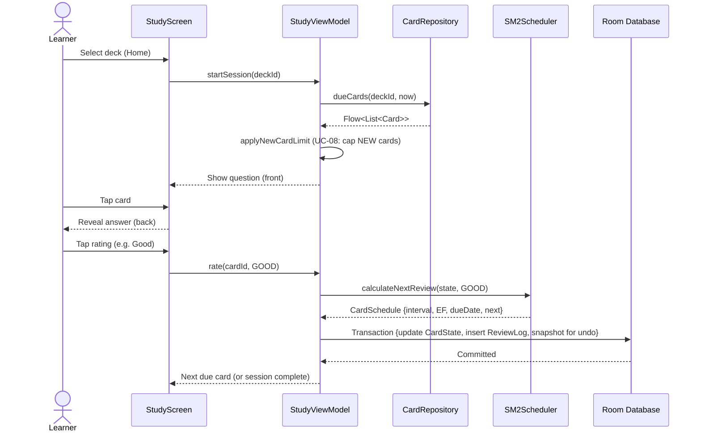
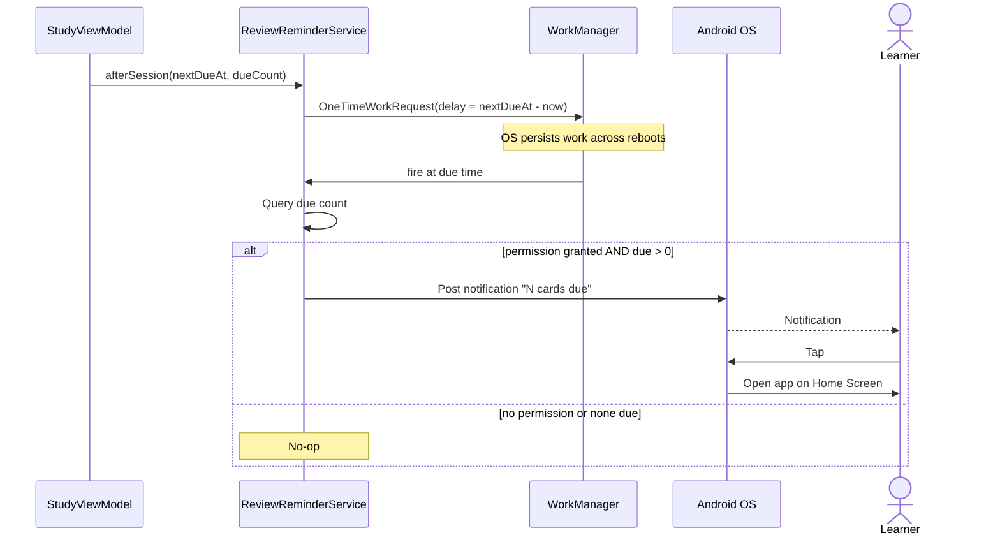
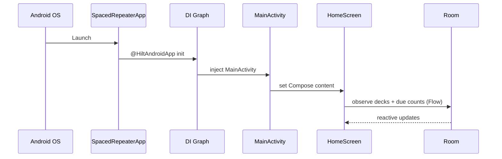

# 6. Runtime View

## 6.1 Deck Import

Covers [UC-01](../use-cases/use-cases.md#uc-01-import-deck). Import is transactional: either the deck appears complete (minus explicitly skipped cards) or nothing is persisted.

Error handling: validation failures abort before any DB write; per-card parse failures are skipped and reported (`imported N, skipped M`); the source archive is never modified.

## 6.2 Study Session

Covers [UC-03](../use-cases/use-cases.md#uc-03-study-deck) and [UC-04](../use-cases/use-cases.md#uc-04-rate-recall).

Key properties:

- The rating transaction is atomic — state update and review log commit together ([data durability](10-quality-requirements.md)).
- Undo uses the pre-review snapshot written inside the same transaction ([UC-05](../use-cases/use-cases.md#uc-05-undo-review)).
- Scheduler runs on the JVM with no framework dependency; the same code path is unit tested.

## 6.3 Review Reminder

Covers [UC-07](../use-cases/use-cases.md#uc-07-receive-review-reminder).

## 6.4 App Startup

