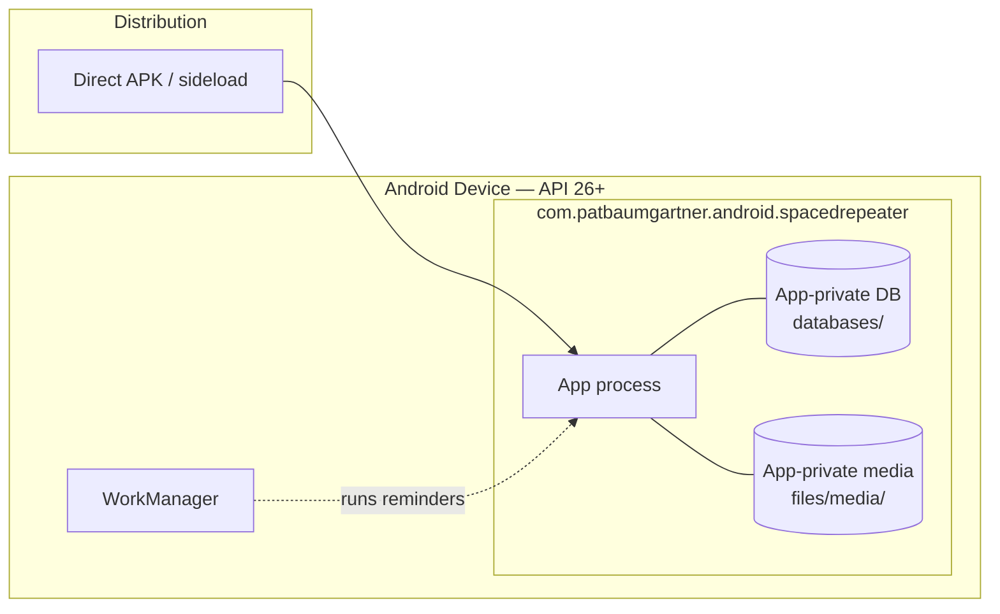

# 7. Deployment View

## 7.1 Deployment Context

A single artifact ships to a single node: the learner's Android device. There are no servers.

## 7.2 Infrastructure Mapped to Building Blocks

| Node / Storage | Building Blocks | Notes |
|----------------|-----------------|-------|
| App process (foreground) | MainActivity, ViewModels, screens, components | Compose UI; single task. |
| App process (background) | ReviewReminderService via WorkManager | Work requests survive process death and reboots. |
| `databases/` (app-private) | Room database | Only writable location for structured data. |
| `files/media/` (app-private) | Imported images | Referenced by cards; removed with deck deletion. |
| Cache dir (temp) | Import extraction staging | Cleared after import; safe to lose. |

## 7.3 Build Variants

| Variant | minifyEnabled | shrinkResources | Purpose |
|---------|---------------|-----------------|---------|
| `debug` | false | false | Development; verbose logging. |
| `release` | true | true | Distribution; ProGuard/R8, signed. |

## 7.4 Permissions Mapping

| Permission | Purpose | Scope |
|------------|---------|-------|
| `POST_NOTIFICATIONS` (runtime, API 33+) | Review reminders | Optional; app fully functional without it. |
| `READ_EXTERNAL_STORAGE` (max SDK 32) | SAF fallback on old devices | Optional. |
| `INTERNET` | Reserved for future sync | No network usage. |
| `FOREGROUND_SERVICE` | Reserved for optional background work | Not used in the current release. |
