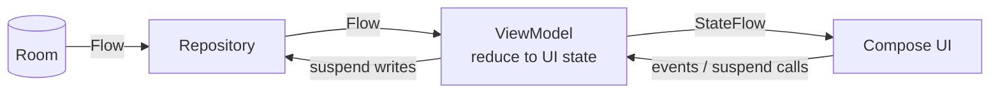

# 8. Cross-cutting Concepts

## 8.1 Domain Primacy

Business rules live in `domain/` as pure Kotlin. The SM-2 scheduler and Markdown parser have **zero Android dependencies**, so the correctness-critical core runs in fast JVM unit tests. Data and UI layers adapt to the domain, never the reverse.

## 8.2 State & Data Flow

Unidirectional data flow (UDF) everywhere:

- ViewModels expose one immutable UI state object via `StateFlow`.
- Screens render state and forward intents; they contain no logic.
- Room `Flow`s keep due counts and deck lists live without manual refresh.

## 8.3 Transactions & Consistency

| Operation | Transaction boundary |
|-----------|---------------------|
| Import | One transaction: deck + all cards + initial states. |
| Rating | One transaction: card-state update + review-log insert + undo snapshot. |
| Undo | One transaction: restore snapshot + delete log entry. |

Partial states are never visible: a crash mid-import leaves no half-imported deck.

## 8.4 Error Handling

| Failure | Handling |
|---------|----------|
| Invalid `deck.json` / empty archive | Abort before DB write; actionable error message. |
| Individual card parse failure | Skip card; report `imported N, skipped M`. |
| Missing media file | Render card without image; never crash. |
| DB write failure | Surface as user-facing error; no silent data loss. |

## 8.5 Theming & Design Language

- Colors ported from the watchdog reference: BrandCyan `#00AFE1`, Porcelain/Graphite backgrounds, Ink/Bone text, Coral errors, Amber warnings.
- Typography: **Manrope** (Light 44sp display, Medium 20sp headline, Regular 16sp body, Medium 12–14sp labels).
- Material 3 components, rounded corners, system-aware light/dark themes, transparent system bars.
- All values defined once in `ui/theme/` (`Color.kt`, `Font.kt`, `Theme.kt`); screens reference theme tokens only.

## 8.6 Concurrency

- Coroutines throughout; `Dispatchers.IO` for import, ZIP extraction, and DB writes.
- Main thread does only UI work; no blocking calls (Room suspend APIs, no `runBlocking` in production code).
- ViewModel scope cancels work when a screen leaves composition.

## 8.7 Logging & Privacy

- Debug builds: verbose logging.
- Release builds: no logging of card content, deck names, or review data — card content may be personal.
- Crash reporting is intentionally absent (privacy goal); issues are reported manually.

## 8.8 Testing Strategy

| Level | Target | Tooling |
|-------|--------|---------|
| Unit (JVM) | SM-2 scheduler, MarkdownParser | JUnit + Kotest-style assertions; pure functions, exhaustive rule coverage |
| Integration | DeckImporter end-to-end (fixture ZIP → DB) | Room in-memory DB, Robolectric or instrumented |
| UI | Study session flow, import flow | Compose UI tests |
| CI | Lint + tests + debug build per push | GitHub Actions, matching watchdog workflows |

Scheduler tests must cover: fresh card, learning steps (1 min → 10 min → graduate), ease floor at 1.3, Easy bonus, lapse resets, and interval rounding.
