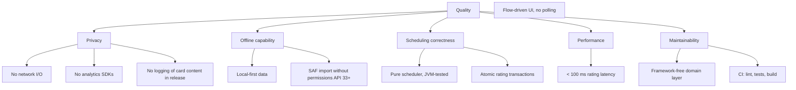

# 10. Quality Requirements

## 10.1 Quality Scenarios (prioritized)

| # | Quality | Scenario | Response Measure |
|---|---------|----------|------------------|
| Q1 | Privacy | The app runs on a device with airplane mode for its entire lifetime. | All features work; zero network traffic in packet capture. |
| Q2 | Scheduling correctness | A card rated Good with EF 2.5, interval 10 is reviewed. | Next interval = round(10 × 2.5) = 25 days; EF unchanged. Matches Anki. |
| Q3 | Data durability | The process is killed immediately after a rating tap. | Card state and review log are either both persisted or both absent — never one without the other. |
| Q4 | Responsiveness | Learner taps a rating. | Next card renders within 100 ms on a mid-range device. |
| Q5 | Offline capability | Device in airplane mode; import + study + stats. | All flows complete successfully. |
| Q6 | Maintainability | FSRS replaces SM-2 in a later release. | Only the scheduler module changes; UI, DB, import untouched. |
| Q7 | Testability | The SM-2 rules change. | Exhaustive rule coverage runs in < 5 s on the JVM, no emulator. |

## 10.2 Quality Tree (excerpt)

## 10.3 Trade-offs

- **SM-2 over FSRS** — simpler and proven, at the cost of less accurate intervals; deferred intentionally ([ADR-0004](../adr/0004-sm2-scheduling-algorithm.md)).
- **No crash reporting** — maximum privacy at the cost of missing telemetry; quality relies on CI and tests instead.
- **Single-level undo** — small scope, matches the current plan; session snapshot design does not preclude multi-level undo later.
