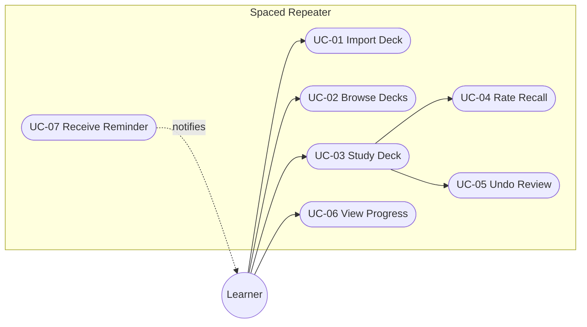
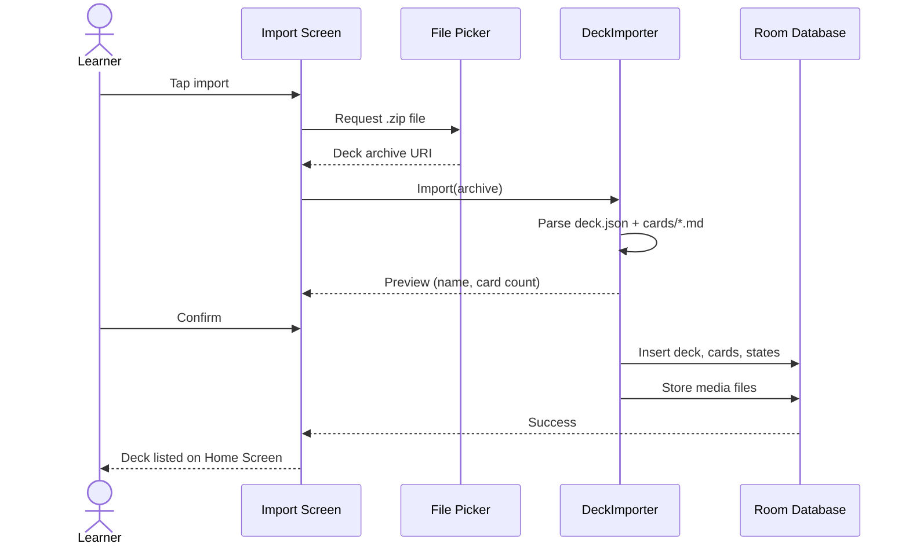
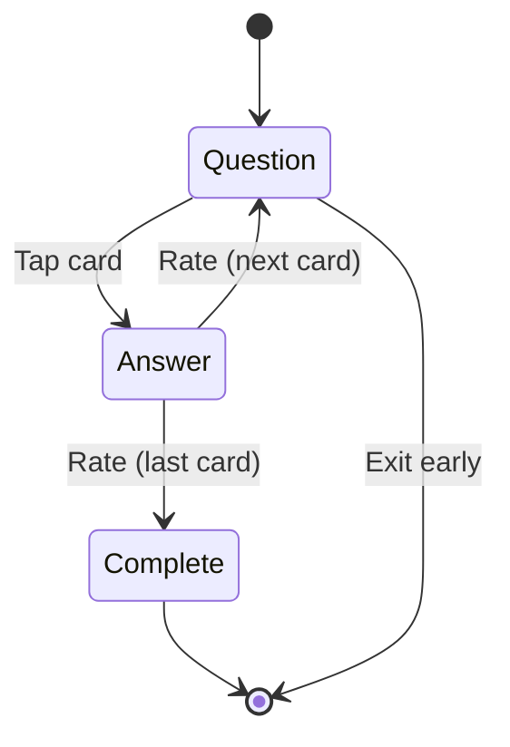

# Use Cases

Spaced Repeater use cases describe the learner workflows and expected behavior
for the initial product scope.

## Actors

| Actor | Type | Description |
|-------|------|-------------|
| Learner | Primary | Studies decks and rates recall quality |
| Deck Author | Secondary | Produces `.zip` deck packages (outside the app) |
| System Clock | Supporting | Triggers due-card scheduling and reminders |

## Use Case Map

## Catalog

| ID | Name | Actor | Priority |
|----|------|-------|----------|
| [UC-01](#uc-01-import-deck) | Import Deck | Learner | High |
| [UC-02](#uc-02-browse-decks) | Browse Decks | Learner | High |
| [UC-03](#uc-03-study-deck) | Study Deck | Learner | High |
| [UC-04](#uc-04-rate-recall) | Rate Recall | Learner | High |
| [UC-05](#uc-05-undo-review) | Undo Review | Learner | Medium |
| [UC-06](#uc-06-view-progress) | View Progress | Learner | Medium |
| [UC-07](#uc-07-receive-review-reminder) | Receive Review Reminder | Learner | Medium |

---

## UC-01 Import Deck

**Actor:** Learner

A learner imports a deck package (`.zip`) so its cards become available for study.

### Main Success Scenario

1. Learner taps the import action on the Home Screen.
2. System opens the system file picker filtered to `.zip` files.
3. Learner selects a deck package.
4. System parses `deck.json` metadata and shows a preview (deck name, card count).
5. Learner confirms the import.
6. System extracts the archive, parses each markdown card, and copies media files to app-private storage.
7. System persists the deck, cards, and initial card states in the local database.
8. System shows the new deck on the Home Screen with a success confirmation.

### Extensions

- **3a. Unsupported file type:** System shows an error and returns to step 2.
- **4a. Missing or invalid `deck.json`:** System shows a validation error; import aborts with no data written.
- **6a. Card file fails to parse:** System skips the card, records the count, and reports partial success at step 8.
- **6b. Missing media reference:** System renders the card without the image.

### Business Rules

- Imports are all-or-nothing per card; a deck with zero valid cards is rejected.
- Import never mutates the source archive.

---

## UC-02 Browse Decks

**Actor:** Learner

A learner views all imported decks with their study status to decide what to study next.

### Main Success Scenario

1. Learner opens the app.
2. System shows the Home Screen listing all decks.
3. For each deck, system shows: name, total card count, due-card badge, and studied/total progress.
4. Learner selects a deck to study or starts another action (import, settings).

### Business Rules

- The list updates reactively when decks or due counts change.
- Decks are sorted by most recently studied, then by name.

---

## UC-03 Study Deck

**Actor:** Learner

A learner works through the due cards of a deck in a focused review session.

### Main Success Scenario

1. Learner selects a deck on the Home Screen.
2. System loads due cards (learning queue first, then reviews sorted by overdue amount).
3. System shows the question (front) full-screen.
4. Learner taps the card to reveal the answer.
5. Learner rates recall (triggers [UC-04](#uc-04-rate-recall)).
6. System shows the next due card.
7. Steps 3–6 repeat until no due cards remain.
8. System shows a session-complete summary.

### Extensions

- **1a. No cards are due:** System shows "All caught up" and returns to the Home Screen.
- **5a. Learner taps undo:** Trigger [UC-05](#uc-05-undo-review).
- **7a. Learner exits early:** System persists the session state; progress for rated cards is kept.

---

## UC-04 Rate Recall

**Actor:** Learner

A learner rates how well they recalled a card; the SM-2 scheduler computes the next due date.

### Main Success Scenario

1. The answer is visible and the four rating buttons are shown.
2. Learner selects Again, Hard, Good, or Easy.
3. System records the rating and review duration in the review log.
4. The SM-2 scheduler updates `repetitions`, `easeFactor`, `interval`, and `dueDate` on the card state.
5. System transitions the card (learning → graduated, or review → rescheduled; Again → relearning).

### Business Rules

| Rating | Effect |
|--------|--------|
| Again (0) | Lapse: repetitions reset to 0, interval = 1 day, ease factor decreases (floor 1.3), card re-enters learning |
| Hard (1) | Interval = 6 days if graduating, else `previous × easeFactor` (no bonus) |
| Good (2) | Standard SM-2 progression |
| Easy (3) | Standard progression plus 1.3× interval bonus, ease factor increases |

- Ease factor never drops below 1.3.
- New and lapsed cards follow the learning steps: 1 min → 10 min → graduate to 1-day interval.

---

## UC-05 Undo Review

**Actor:** Learner

A learner reverts the most recent rating within the current session, e.g. after a mis-tap.

### Main Success Scenario

1. Learner taps Undo on the Study Screen.
2. System restores the previous card state from the pre-review snapshot.
3. System removes the corresponding review-log entry.
4. The card is presented again in its pre-review state.

### Extensions

- **1a. No review to undo in this session:** The undo action is disabled.

### Business Rules

- Undo is limited to the current session and the most recent review only (single-level undo, per plan scope).

---

## UC-06 View Progress

**Actor:** Learner

A learner checks study progress and forecast to stay motivated.

### Main Success Scenario

1. Learner opens the Stats entry point from the Home Screen.
2. System shows: cards studied today, retention rate (share of non-Again answers), and study streak.
3. Learner returns to the Home Screen.

### Business Rules

- Statistics are computed from the review log; no separate analytics store.
- The stats screen is optional and must not block the study flows.

---

## UC-07 Receive Review Reminder

**Actor:** Learner (recipient); System Clock (trigger)

A learner is notified when cards are due, re-engaging the study habit.

### Main Success Scenario

1. The background service computes the next due timestamp after a study session.
2. System schedules a review reminder at that time.
3. At the scheduled time, the system posts a notification ("N cards are due").
4. Learner taps the notification; the app opens on the Home Screen.

### Extensions

- **3a. Notification permission not granted:** No notification is posted; the app still works.
- **3b. No cards due:** No reminder is scheduled.

### Business Rules

- Reminders are derived from real due dates, not fixed intervals.
- The feature is fully optional and disabled until the learner grants `POST_NOTIFICATIONS`.
